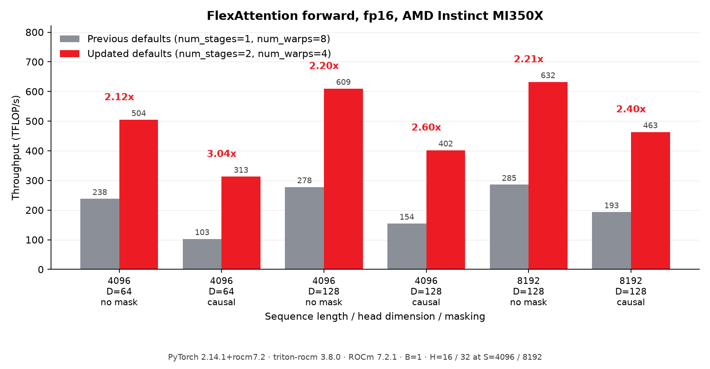
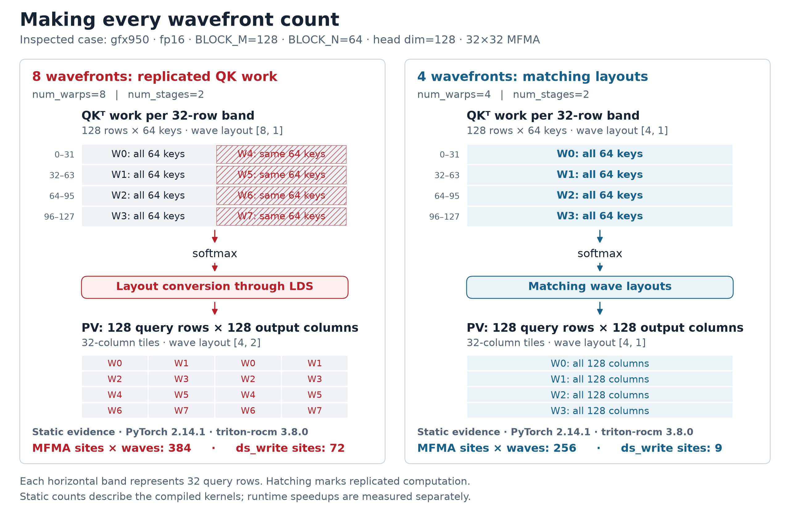
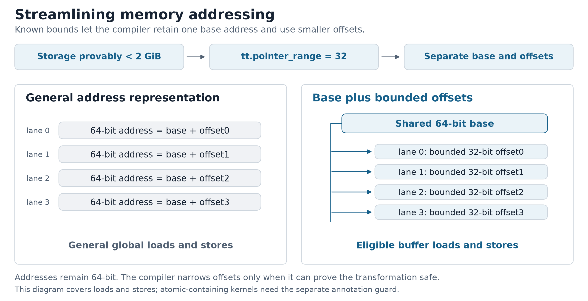

# Flexible by Design, Fast by Default

*Tuning PyTorch FlexAttention for AMD Instinct MI350X*

FlexAttention lets users express attention variants as Python functions that
`torch.compile` turns into fused kernels. On AMD Instinct MI350X, tuning two
configuration defaults improved **fp16 forward throughput by 2.1x to 3.0x** on
the workloads we measured. The algorithm and user-facing API stayed the same:
the changes reduced the wavefront count from eight to four and increased the
software-pipeline depth from one stage to two.

The impact extends to applications. Researchers at MIT CSAIL used FlexAttention
for the block-causal sliding-window attention in *Mirror: Self-Improving
Video-to-Action Models*, finetuning their Minecraft Diamond video planners on
16 MI350X GPUs. Their [paper](https://arxiv.org/html/2610.24177v1#A1) describes the
attention design. In measurements shared by the team, tuning guidance and
follow-up changes reduced attention latency from **27.18 to 16.05 ms**, a
**1.69x speedup**. Reported planner throughput increased from **15.8 to 19.9
video-seconds per second**, **26% higher**, excluding VAE and text processing.
These are team-reported application results from the combined tuning effort.



*Forward measurements on official PyTorch 2.14.1+rocm7.2, triton-rocm 3.8.0,
ROCm 7.2.1. Previous settings: `(num_stages, num_warps) = (1, 8)`; updated:
`(2, 4)`. Batch size is 1; head dimensions are 64 and 128. There are 16 heads
at sequence length 4096 and 32 at 8192. Both configurations use the same build.*

## What FlexAttention chooses for you

For each query tile, the forward kernel walks through key/value blocks. Each
iteration computes `QKᵀ`, applies the score modification and mask, updates the
online softmax, then accumulates `PV`. Online softmax carries running maxima
and normalization factors so the full attention matrix never needs to be stored.

Inductor chooses the query tile height `BLOCK_M`, key/value tile width `BLOCK_N`,
pipeline depth `num_stages`, and cooperating wavefront count `num_warps`.
Each gfx950 wavefront contains 64 threads. Tiles reuse data, but their
accumulators and prefetched operands consume registers and shared memory, called
LDS. MI350X provides [160 KB of LDS per compute unit](https://rocm.docs.amd.com/en/docs-7.2.4/how-to/rocm-for-ai/inference-optimization/workload.html#architecture-comparison).
Those resources constrain how much work can run concurrently.

The default compile mode selects settings from an architecture table.
`max-autotune` measures candidate configurations. Both rely on the compiler
turning each configuration into an efficient assignment of work.

## Making Every Wavefront Count

The fp16 defaults used eight wavefronts at head dimensions 64 and 128, while
bf16 used four. Changing fp16 to four[^1] improved forward throughput by
**1.86x to 2.63x** with two pipeline stages held fixed. The generated layouts
explain why.

In the inspected `BLOCK_M=128`, `BLOCK_N=64`, head-dimension-128 kernel, the
matrix instruction `v_mfma_f32_32x32x16_f16` produces a 32x32 output fragment
collectively across a wavefront. Four 32-row bands cover the tile's 128 query
rows. The two matrix products distribute wavefronts differently:



*fp16 on gfx950, head dimension 128, tile 128x64, two stages. The counters are
static compiler sites from the release build; MFMA counts are weighted by
wavefront count.*

For `QKᵀ`, Triton assigns all eight wavefronts along query rows, a `[8, 1]`
layout. Pairs of wavefronts compute the same bands. For `PV`, four wavefronts
cover the rows and two divide output columns, a `[4, 2]` layout. Moving the
softmax result between these assignments requires a conversion through LDS.

With four wavefronts, both products use `[4, 1]`. The QK bands have distinct
owners, and the intermediate values already have the layout PV needs.
This removes redundant matrix work and that shared-memory conversion.

The assembly contains 64 static MFMA sites with four wavefronts and 48 with
eight. Weighting them by wavefront count gives **256 versus 384**; static
`ds_write` sites fall from **72 to 9**. These are evidence for the mechanism:
loop iterations and masking determine dynamic instruction counts, while the
benchmarks establish the runtime gain.

One setting changes; the rendered Triton kernel body stays the same. The
compiler derives different layouts and instructions. This is why wavefront
count belongs in the tuning space alongside tile shape: the useful assignment
depends on both matrix products, their instruction geometry and the softmax
between them.

## Overlapping Loads and Computation

Increasing the default pipeline depth from one stage to two[^2] lets Triton
schedule loads for upcoming key/value blocks alongside work on the current
block. On the measured bf16 workloads, which already use four wavefronts,
this improves forward throughput by **1.10x to 1.18x**.

Prefetching also keeps more state live. For fp16 at head dimension 64 with
eight wavefronts, two stages slightly reduce throughput: **237.9 to 231.9
TFLOP/s**, or 0.97x. The saved build increases total VGPR allocation from
128 to 140 and shared memory from 16,384 to 50,112 bytes; compiler-reported
occupancy falls from four to three waves per SIMD. That resource tradeoff is
consistent with the slowdown, although it does not isolate its cause.

The same shape benefits from pipelining with four wavefronts. Together, the
two changes deliver the larger fp16 gains in the opening chart. Pipeline
depth and wavefront count need to be evaluated as a combination.

## Streamlining Memory Addressing

A kernel spends instructions calculating addresses as well as moving data.
When offsets fit in 32 bits, eligible AMD buffer operations can express an
access using a shared 64-bit base and smaller per-thread offsets. The accessed
addresses remain 64-bit.



Inductor supplies a pointer-range annotation[^3] for HIP tensor arguments whose
storage is provably smaller than 2 GiB. Triton uses that information to
canonicalize pointers and lower eligible accesses to buffer operations. It
can also narrow eligible expressions that initially use 64-bit offsets.[^4]
Both configurations in the forward-default comparisons already use this path.

A separate MI350X experiment held the configuration fixed and toggled the
annotation. Buffer operations improved throughput by **1.31x for causal**
attention and **1.04x for unmasked** attention at `B=1, H=16, S=4096, D=128`,
fp16, tile 128x64, two stages and four wavefronts, with grad mode disabled.
It used PyTorch `2.14.0a0+gitb5460ee` with modified Python sources at
`37200109b999`, and Triton `3.8.0+gitc8305ccc`.

The causal assembly offers a clue to the larger gain: buffer lowering reduces
total VGPR allocation from 260 to 252 and raises compiler-reported occupancy
from one to two waves per SIMD. The unmasked case stays at two. Address
generation and predication also change, so these resource estimates support
an explanation rather than identify a single cause.

Bounds also need consistent safeguards. Inductor suppresses the annotation
for user-defined Triton kernels where it cannot establish the bounds.[^5]
A template-path fix[^6] applies the same controls to FlexAttention, including
suppression for captured-gradient atomics so highly contended accumulation
can use global atomics.

## Better Defaults for Backward

Training computes three gradients. dK/dV holds a key/value tile fixed and
walks query blocks; dQ holds a query tile fixed and walks key/value blocks.
Each traversal has its own tile pair, tuned with the pipeline depth.

The gfx950 default update[^7] selects
`(BLOCK_M1, BLOCK_N1, BLOCK_M2, BLOCK_N2, num_stages, num_warps) =
(32, 128, 128, 32, 2, 4)` for fp16 and bf16 at head dimensions 64 and 128.
Across 11 measured workloads, bf16 backward improves by **1.13x to 2.26x**;
the two fp16 cases improve by **2.08x at D64** and **1.17x at D128**.
Five representative bf16 results are:

| Sequence length | Head dim | Query/KV heads | Mask | Backward speedup |
|---|---|---|---|---|
| 2048 | 64 | 16/16 | causal | 1.79x |
| 8192 | 64 | 16/16 | causal | 2.26x |
| 4096 | 128 | 16/16 | causal | 1.17x |
| 4096 | 128 | 16/4 | causal | 1.41x |
| 4096 | 128 | 16/16 | causal window, 1024 | 1.34x |

*Batch size 1. Complete backward latency, including preprocessing and reductions.
The change has landed upstream but is absent from PyTorch 2.14.1; both
configurations are pinned explicitly on that wheel, with triton-rocm 3.8.0 and
ROCm 7.2.1. Windowed attention allows `q_idx - 1024 < kv_idx <= q_idx`.*

The knobs interact here too. For bf16 causal attention at D128 and sequence
lengths 2048–8192, changing only the tiles gives **0.86x–0.89x**, while changing
only the pipeline depth gives **0.93x–0.98x**. Combining them gives
**1.13x–1.18x**. These results establish the benefit of the combined configuration.
The timing alone does not establish a particular register or LDS bottleneck.

### Open PR: Giving Backward Kernels Their Own Schedules

Further specialization[^8] separates dQ and dK/dV into distinct kernel
launches, allowing independent pipeline and compiler settings. In the
inspected D96 path, dK/dV uses one stage while dQ uses two.

The proposed kernels also issue `dP = dO Vᵀ` before reconstructing the softmax
probabilities, exposing independent matrix work earlier. For selected D128
grouped-query inputs, query heads sharing a KV head reuse a walk through the
query-block metadata. Together, these changes offer better scheduling and
less repeated mask traversal.

Comparing the PR with its exact parent gives **1.18x to 2.93x faster complete
backward** across 23 supported configurations. Examples:

| Data type | Batch | Query/KV heads | Sequence length | Head dim | Mask | Backward speedup |
|---|---|---|---|---|---|---|
| bf16 | 4 | 21/21 | 4096 | 96 | dense | 2.86x |
| fp16 | 2 | 64/8 | 4096 | 128 | causal | 1.86x |
| fp32 | 4 | 64/8 | 2048 | 128 | causal | 2.87x |

*MI350X, ROCm 7.2.1, PyTorch 2.16.0a0 source builds: parent `656560bcbe2f`
versus PR `d64287342982`, both using Triton `fc8d31a5439e`. Automatic selection
is measured with autotuning disabled and `BACKEND="TRITON"`; supported paths
are guarded, and explicit tuning settings take precedence.*

## Using the Improvements

PyTorch 2.14.1 ROCm already selects the updated forward defaults for fp16 and
bf16 at D64 and D128. Given Q/K/V tensors and a `BlockMask` created from your
mask function, the call remains:

```python
import torch
from torch.nn.attention.flex_attention import flex_attention

compiled = torch.compile(flex_attention, fullgraph=True)
out = compiled(q, k, v, block_mask=block_mask)
```

For your own shapes, `torch.compile(flex_attention, mode="max-autotune",
fullgraph=True)` benchmarks candidates; `kernel_options` lets you pin settings
for controlled comparisons. Architecture-specific tables[^9] let MI300X and
MI350X evolve their defaults independently as their LDS and matrix-throughput
budgets differ. The table split preserves the gfx950 settings measured here.

## How We Measured

All measurements use MI350X. Configuration comparisons pin settings on the
same build with autotuning off. Forward timing uses grad mode enabled and
inputs without gradients, emitting LSE but timing only forward. Three fresh
processes retain six trials per configuration; forward results use medians
of process medians. The worst within-configuration trial spread is 4.49%.
GPUs are checked idle before timing and monitored for competing processes.

Backward results compare complete-pass latencies.
Outputs and gradients pass independent FP64 checks with two seeds. Each
kernel comparison uses its stated baseline; the speedups should not be
multiplied or read as training-step gains. The
[supporting guide](data/README.md) retains the full results, exact environments,
tolerances, compiler evidence and reproduction commands.

## Pull Request References

[^1]: [PyTorch #180720: Change the fp16 default from eight to four wavefronts](https://github.com/pytorch/pytorch/pull/180720).
[^2]: [PyTorch #176676: Enable software pipelining for FlexAttention](https://github.com/pytorch/pytorch/pull/176676).
[^3]: [PyTorch #176675: Emit pointer-range annotations for small tensor arguments](https://github.com/pytorch/pytorch/pull/176675).
[^4]: [Triton #9619: Enable buffer operations for eligible 64-bit offsets](https://github.com/triton-lang/triton/pull/9619).
[^5]: [PyTorch #178541: Suppress pointer-range annotations for user-defined Triton kernels](https://github.com/pytorch/pytorch/pull/178541).
[^6]: [PyTorch #194136: Apply pointer-range guards to template kernels](https://github.com/pytorch/pytorch/pull/194136).
[^7]: [PyTorch #194151: Add gfx950 FlexAttention backward defaults](https://github.com/pytorch/pytorch/pull/194151). Landed at [`1e9d530d4a9`](https://github.com/pytorch/pytorch/commit/1e9d530d4a901a846f06d65f925d4b98fe842b2b).
[^8]: [PyTorch #200959: Optimize FlexAttention backward on gfx950](https://github.com/pytorch/pytorch/pull/200959). **Open.** Measured revision [`d64287342982`](https://github.com/pytorch/pytorch/commit/d642873429820f9f05d26958a83bc8503e9b528f).
[^9]: [PyTorch #181283: Add architecture-specific FlexAttention defaults](https://github.com/pytorch/pytorch/pull/181283).
