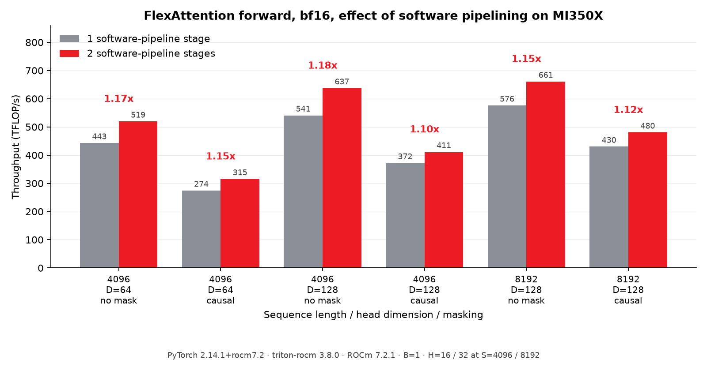

# Tuning PyTorch FlexAttention for AMD Instinct MI350X

PyTorch's [FlexAttention](https://pytorch.org/blog/flexattention/) lets you express
attention variants — causal masks, sliding windows, ALiBi, soft-capping — as small
Python functions that `torch.compile` fuses into a Triton kernel. The kernel's
configuration determines how well it uses the GPU. On AMD Instinct MI350X, two
changes to the ROCm defaults improved fp16 forward throughput by **2.1x to 3.0x**
on the shapes we measured: increasing the software-pipelining depth from one to
two stages and reducing the wavefront count from eight to four.


*Combined effect of `num_stages=1 → 2` and `num_warps=8 → 4`, with both configurations
compiled on official PyTorch 2.14.1+rocm7.2 with triton-rocm 3.8.0. Batch size is 1;
the tests cover head dimensions 64 and 128, sequence lengths 4096 and 8192, and
unmasked and causal attention.*

The bf16 defaults already used four wavefronts, so they benefit from the
pipelining change alone: **1.10x to 1.18x**. These configuration changes are included
in the [PyTorch 2.14.1 ROCm defaults](https://github.com/pytorch/pytorch/blob/5c4886908584029761b579af026dcfb627c84070/torch/_inductor/heuristics/template/triton.py).

Backward tuning improves performance by **1.13x to 2.26x** on the tested bf16
workloads; that change has landed upstream but is absent from this release.
The investigation also led to architecture-specific defaults and improvements
to memory addressing in Inductor and Triton. Together, they show how configuration
choices and compiler lowering shape the performance of the same attention algorithm.

## How Inductor configures FlexAttention

Inductor fills in a Triton template with the query tile height `BLOCK_M`, the
key/value tile width `BLOCK_N`, the software-pipelining depth `num_stages`, and the
number of wavefronts cooperating on each tile, `num_warps`. In the default compile
mode, it chooses a configuration from a table. With
`torch.compile(mode="max-autotune")`, it benchmarks candidate configurations.

A wavefront is a group of GPU threads that execute together; on gfx950 it contains
64 threads. Wavefronts cooperate on the attention kernel's two matrix products:
`QKᵀ`, followed by softmax, then `PV`. Their assignment to those products determines
both how much work they perform and whether intermediate results need to move
between them.

## Making Every Wavefront Count

The fp16 defaults used `num_warps=8` at head dimensions 64 and 128, while bf16 used
four for the same shapes. Changing the fp16 default to four[^1] improved forward
throughput by **1.86x to 2.63x**, holding `num_stages=2` fixed:

| Sequence length | Head dim | Mask | 8 wavefronts | 4 wavefronts | Speedup |
|---|---|---|---|---|---|
| 4096 | 64 | none | 231.9 | 504.2 | 2.17x |
| 4096 | 64 | causal | 119.1 | 312.8 | 2.63x |
| 4096 | 128 | none | 327.3 | 609.3 | 1.86x |
| 4096 | 128 | causal | 187.1 | 401.6 | 2.15x |
| 8192 | 128 | none | 333.5 | 631.9 | 1.90x |
| 8192 | 128 | causal | 227.9 | 463.2 | 2.03x |

*Forward throughput in TFLOP/s; higher is better. Both columns use `BLOCK_M=128`,
`BLOCK_N=64`, and `num_stages=2`. The upstream PR also measures larger batches and
reports a consistent benefit.*

The generated code explains why fewer wavefronts help. In the inspected fp16,
head-dimension-128 kernel, both configurations use the same matrix instruction,
`v_mfma_f32_32x32x16_f16`, which produces a 32×32 output tile per wavefront. Four
such tiles cover the 128 query rows. Asking for eight wavefronts changes how
Triton distributes that work across the two matrix products.


*Work assignments for `BLOCK_M=128`, `BLOCK_N=64`, head dimension 128, fp16 on
gfx950. The two QK assignments in each band on the left cover the same keys;
the two PV wavefronts divide alternating 32-column tiles. The counters come from
the PyTorch 2.14.1 release campaign and count static compiler sites, with MFMA
sites weighted by wavefront count.*

Triton's first matrix product assigns all wavefronts along the query-row axis,
keeping each softmax row within a wavefront. With eight wavefronts, pairs of them
compute the same QK bands. For the second product, Triton assigns four wavefronts
along the rows and two along the output columns. Moving between those layouts
requires a conversion through LDS, the GPU's shared memory. With four
wavefronts, both products use a `[4, 1]` layout.

On the release build, the saved assembly contains 384 wave-weighted MFMA
instruction sites with eight wavefronts, versus 256 with four. Static `ds_write`
sites fall from 72 to 9. These counts support the explanation of redundant
computation and the added layout conversion; the throughput table measures
the runtime impact of changing the wavefront count. The [compiler appendix](#compiler-appendix)
includes the layout details and inspectable artifacts.

The change to Inductor is one configuration value. The rendered Triton kernel
body stays the same, while the compiler derives different layouts and machine
instructions from that value. For other tile sizes and instruction geometries,
inspect both matrix products and measure the candidates. The demonstrated benefit
of four wavefronts is specific to these configurations.

## Overlapping memory loads and computation

Triton's software pipeliner can schedule loads for upcoming key/value blocks
alongside computation on the current block. The ROCm defaults used
`num_stages=1`, limiting that software-pipelining opportunity. Increasing the
default to two stages[^2] provides a consistent gain on the measured bf16 cases:



| Sequence length | Head dim | Mask | 1 stage | 2 stages | Speedup |
|---|---|---|---|---|---|
| 4096 | 64 | none | 442.9 | 519.4 | 1.17x |
| 4096 | 64 | causal | 274.2 | 315.2 | 1.15x |
| 4096 | 128 | none | 540.9 | 637.3 | 1.18x |
| 4096 | 128 | causal | 372.0 | 411.0 | 1.10x |
| 8192 | 128 | none | 576.2 | 660.9 | 1.15x |
| 8192 | 128 | causal | 430.1 | 480.3 | 1.12x |

*Forward throughput in TFLOP/s, with four wavefronts in both columns. The upstream
review swept 16 shapes with [attention-gym](https://github.com/meta-pytorch/attention-gym)
and reported a geometric mean speedup of 1.13x.*

The two knobs interact. In the grad-enabled forward setup measured here,
pipelining is slightly negative with eight wavefronts on the unmasked fp16
head-dimension-64 case: 237.9 to 231.9 TFLOP/s, or 0.97x. With four wavefronts,
pipelining benefits that shape. The reproduction harness measures all four
combinations so each effect can be checked in the same execution context.
When tuning a new target, benchmark combinations of tile size, wavefront count,
and pipeline depth.

## Better Defaults for Backward

Training computes gradients for queries, keys and values. The dK/dV work holds
a key/value tile fixed while walking query blocks; dQ holds a query tile fixed
while walking key/value blocks. Each traversal has its own tile pair, and both
need to be tuned with the pipeline depth.

The gfx950 backward-default update[^3] does this for fp16 and bf16 at head
dimensions 64 and 128. It selects
`(BLOCK_M1, BLOCK_N1, BLOCK_M2, BLOCK_N2, num_stages, num_warps) =
(32, 128, 128, 32, 2, 4)`. The first pair controls dK/dV, the second dQ.

Independent measurements on MI350X show **1.13x to 2.26x faster bf16
backward** across the tested causal, grouped-query and sliding-window workloads.
At sequence length 4096 with 16 query and KV heads, fp16 improves by
**2.08x at head dimension 64** and **1.17x at 128**.
The tile and pipeline changes work together. For bf16 causal attention at head
dimension 128 and sequence lengths 2048–8192:

| Change from previous defaults | Backward speedup |
|---|---|
| Tile shape alone | 0.86x–0.89x |
| Two pipeline stages alone | 0.93x–0.98x |
| Tile shape and two stages together | 1.13x–1.18x |

*Values below 1x indicate a slowdown. Batch size is 1, with 16 query and KV heads.*

This change has landed upstream and is absent from the PyTorch 2.14.1 wheel used
for this comparison. We set both configurations explicitly on that same build,
check outputs and all three gradients against FP64, and time the complete
backward pass in two processes. The [backward validation report](data/backward-validation-2026-10-21/README.md)
contains all 11 workloads, exact options, numerical checks and raw trials.
Training-step gains depend on the fraction of time spent in attention backward.

## Streamlining Memory Addressing

Memory access has an instruction cost beyond transferring the tensor values.
A kernel must also calculate their addresses. When the compiler can prove that
tensor offsets fit in 32 bits, it can represent those accesses as a shared
64-bit base plus smaller offsets and use eligible AMD buffer loads and stores.


*The accessed addresses remain 64-bit. The optimization narrows the offsets
where the compiler can prove that doing so preserves the addresses.*

Inductor supplies that information through a pointer-range annotation[^4]: on
HIP, tensor arguments whose storage is provably smaller than 2 GiB receive
`tt.pointer_range=32`. Triton's pointer canonicalization and buffer-operation
lowering can then use the bounded-offset representation.
The compiler suppresses the annotation for user-defined Triton kernels[^5],
where Inductor cannot establish the necessary pointer bounds.

Triton's 64-bit offset support[^6] also allows eligible offset expressions to
reach buffer operations when it can
prove they are safe to narrow. The useful condition is the proof of the offset
range; the expression's initial integer width alone does not decide eligibility.

### Applying the controls to template kernels

The annotation needs consistent controls across Inductor's code-generation
paths. FlexAttention uses a template path that bypassed both
`TORCHINDUCTOR_EMIT_POINTER_RANGE_32=0` and the existing suppression for kernels
containing atomics. The template guard[^7] shares the annotation policy across
those paths and records atomics emitted by FlexAttention's captured-buffer
gradient lowering. Suppressing the annotation allows global atomics to handle
highly contended gradient accumulation.

This guard has landed upstream and is absent from PyTorch 2.14.1. We independently
checked its effect by restoring the guard on that same release build. The
[appendix](#captured-gradient-atomics-a-contention-stress-test) describes the
synthetic contention measurements and their numerical limits.

### Supporting compiler changes

The buffer path also needed an SSA dominance fix.[^8]
A separate packed fp32-to-bf16 conversion[^9]
uses `v_perm_b32` for round-toward-zero packing; its reported reduction in register
pressure and spills was measured on gfx1250. These changes support efficient
AMD kernels beyond the MI350X comparisons here.

Both columns in the forward configuration comparisons use the same compiler
with buffer operations enabled. They isolate the configuration changes and
do not measure the compiler changes discussed here. A separate [addressing ablation](data/validation-2026-10-19/README.md#memory-addressing-ablation)
at `B=1, H=16, S=4096, D=128`, fp16 with grad mode disabled, measured
**399.6 versus 305.5 TFLOP/s** for
causal attention with and without the buffer path: **1.31x**. The unmasked case
improved by **1.04x**. Saved assembly verifies that the accesses switch between
buffer and global operations. This comparison measures a different change and
contributes no additional factor to the headline result.

## Measurements and reproduction

The combined fp16 results shown in the opening figure are:

| Sequence length | Head dim | Mask | Previous defaults | Updated defaults | Speedup |
|---|---|---|---|---|---|
| 4096 | 64 | none | 237.9 | 504.2 | 2.12x |
| 4096 | 64 | causal | 102.7 | 312.8 | 3.04x |
| 4096 | 128 | none | 277.6 | 609.3 | 2.20x |
| 4096 | 128 | causal | 154.5 | 401.6 | 2.60x |
| 8192 | 128 | none | 285.5 | 631.9 | 2.21x |
| 8192 | 128 | causal | 193.1 | 463.2 | 2.40x |

*Forward throughput in TFLOP/s. Previous: `(128, 64, 1, 8)`; updated:
`(128, 64, 2, 4)`, ordered as `(BLOCK_M, BLOCK_N, num_stages, num_warps)`.*

All forward tables use one MI350X (gfx950), batch size 1, 16 heads at sequence
length 4096 and 32 at 8192, head dimensions 64 and 128, and either no mask or a
causal mask produced by `create_block_mask`. The software is **official PyTorch
2.14.1+rocm7.2**, **triton-rocm 3.8.0**, and **ROCm 7.2.1**, with Python 3.12.3.
The [release record](data/publication-2.14.1-2026-10-20/README.md#frozen-environment)
pins the PyTorch source revision and the exact PyTorch and Triton wheel hashes.

Throughput counts `4 * B * H * D * V` FLOPs, where `V` is the number of live score
entries: `S * S` without a mask or `(S * S + S) / 2` for a causal mask. Compare
configurations within the same row; causal and unmasked throughput count
different amounts of useful work.

### Measurement protocol

We pin previous and updated configurations through `kernel_options` on the same
build, with autotuning disabled. This isolates the settings from changes between
software releases. The forward campaign uses the default grad-enabled context
with inputs that do not require gradients: it emits logsumexp, but times no
backward pass. Disabling grad mode changes the generated kernel and constitutes
a different comparison.

The campaign retains **three fresh processes × 36 configurations × six timing
trials = 648 trials**. Each process uses private compiler caches; the second
reverses configuration order. Before timing each configuration, the harness
checks finite outputs against an eager reference, requires three idle GPU
observations with no competing processes, ramps clocks with eight seconds of
dense matmul, and warms the attention workload for three seconds. Each
`triton.testing.do_bench` trial uses 200 ms warmup and 500 ms of repetitions.
GPU process and clock monitoring continues during timing.

Tables and charts use median throughput across the three processes, each of
which reports its median trial. Ratios use unrounded values. All correctness,
isolation and timing checks passed; the largest within-configuration trial
range was 4.49% of its median. These observed ranges are descriptive, not
confidence intervals. The [release validation report](data/publication-2.14.1-2026-10-20/README.md)
contains raw trials, tolerances, monitoring evidence, generated kernels and
all twelve checks of the unforced forward defaults.

The landed backward comparison uses the same official wheel with old and new
options set explicitly. The open backward PR uses separately pinned source
builds, identified in its section. The addressing ablation has its own linked
environment and protocol. Each comparison measures a different change;
their speedups should not be multiplied.

### Using the updated forward defaults

A PyTorch ROCm build containing the changes uses the updated defaults without
an opt-in flag:

```python
import torch
from torch.nn.attention.flex_attention import create_block_mask, flex_attention

B, H, S, D = 1, 16, 4096, 128
q, k, v = (torch.randn(B, H, S, D, device="cuda", dtype=torch.float16)
           for _ in range(3))
# The mask ignores batch and head indices, so its storage can be shared.
block_mask = create_block_mask(
    lambda b, h, q_idx, kv_idx: q_idx >= kv_idx,
    None, None, S, S, device="cuda",
)
compiled = torch.compile(flex_attention, fullgraph=True)
out = compiled(q, k, v, block_mask=block_mask, scale=D**-0.5)
```

To reproduce the comparisons, use the [benchmark instructions](bench/README.md)
to install the pinned release wheels and run three fresh processes on an
exclusively allocated GPU, with six trials per configuration and private caches.
The [published summary](data/publication-2.14.1-2026-10-20/forward-summary.csv),
raw trials and plot scripts are bundled with this article.

To tune other shapes, use
`torch.compile(flex_attention, mode="max-autotune", fullgraph=True)` and validate
the selected configuration on your workload.

## One default table per architecture

MI300X (gfx942) and MI350X (gfx950) have different LDS capacities and matrix
throughput, so they can favor different tile sizes and wavefront counts. These
settings balance data reuse and latency hiding against the resources needed by
each workgroup. A separate default table for each architecture[^10] allows either
to be tuned without changing the other's defaults. The half-precision forward
entries are shown as `(BLOCK_M, BLOCK_N, num_stages, num_warps)`:

| Data type | Head dim | MI300X (gfx942) | MI350X (gfx950) |
|---|---|---|---|
| bf16 | 64, 128 | 64, 64, 2, 8 | 128, 64, 2, 4 |
| bf16 | 256 | 32, 64, 2, 8 | 32, 64, 2, 4 |
| fp16 | 64, 128 | 64, 32, 1, 8 | 128, 64, 2, 4 |
| fp16 | 256 | 32, 32, 1, 8 | 32, 64, 2, 4 |

These are the entries introduced by the split; our measurements cover MI350X
head dimensions 64 and 128. The split itself leaves the gfx950 values unchanged,
so it contributes no additional MI350X speedup to the figures here. The smaller
MI300X tiles and head-dimension-256 entries also illustrate why the wavefront
count needs to be evaluated with the rest of the configuration.

## Next: Giving Backward Kernels Their Own Schedules

A further backward optimization[^11] is **under review as of October 21, 2026**.
It separates dQ and dK/dV into distinct kernel launches, allowing each to use its
own launch and compiler settings. In the inspected D96 grouped-query path,
dK/dV uses one pipeline stage while dQ uses two.

The proposed kernels also expose independent work earlier: `dP = dO Vᵀ` can be
computed before the attention probabilities have been reconstructed. For
selected D128 grouped-query inputs, the dK/dV traversal shares a walk through
the query-block metadata across query heads that use the same KV head. These
are opportunities for better scheduling and less repeated mask traversal.

We built the PR and its exact parent with the same pinned compiler and measured
automatic selection. Across 23 supported configurations, complete backward
speedups range from **1.18x to 2.93x**. Representative results:

| Data type | Batch | Query/KV heads | Sequence length | Head dim | Mask | Backward speedup |
|---|---|---|---|---|---|---|
| bf16 | 4 | 21/21 | 4096 | 96 | dense | 2.86x |
| fp16 | 2 | 64/8 | 4096 | 128 | causal | 1.86x |
| fp32 | 4 | 64/8 | 2048 | 128 | causal | 2.87x |

*MI350X, ROCm 7.2.1, PyTorch 2.16.0a0 source builds: parent `656560bcbe2f`
versus PR `d64287342982`; Triton `fc8d31a5439e`. Ratios compare median latencies
from the first measurement pass. All 23 configurations passed independent FP64
checks with two seeds; seven received a second performance measurement on both
builds. The [full report](data/backward-validation-2026-10-21/README.md#open-pr-automatic-selection-against-the-actual-parent)
includes every row and repeat.*

Automatic selection is guarded by the supported shapes, layouts, masks and
other input conditions; explicit tuning settings take precedence. These results
describe this PR revision, with its own software baseline, and are not part of
the released forward defaults measured earlier.

## Summary

Revisiting two defaults recovered substantial MI350X performance: four
wavefronts avoid replicated work and a layout conversion in the inspected fp16
kernel, and two pipeline stages improve overlap across key/value iterations.
Together, they deliver 2.1x to 3.0x higher fp16 forward throughput on the measured
shapes, with 1.10x to 1.18x from pipelining alone on bf16.

Backward benefits from the same approach: the landed tile-and-pipeline tuning
improves the tested bf16 workloads by 1.13x to 2.26x. The open kernel
specializations extend that work with independent schedules for dQ and dK/dV.

The practical lesson is to tune the configuration as a whole when bringing up
an architecture. Per-architecture tables give validated defaults a home, and
compiler inspection helps explain which combinations deserve measurement.
`max-autotune` and `kernel_options` expose the same choices for your own shapes.

## Compiler appendix

### How Triton assigns wavefronts

The release campaign's Triton GPU IR records the assignments used by the
wavefront diagram. For fp16, `B=1, H=16, S=4096, D=128`, unmasked, with
`BLOCK_M=128`, `BLOCK_N=64` and two stages, both kernels use
`v_mfma_f32_32x32x16_f16`.

The first matrix product assigns wavefronts along query rows, keeping softmax
reductions within each wavefront. Four 32-row tiles cover the 128 query rows;
eight wavefronts replicate those bands. The second product uses four wavefronts
along the rows and assigns any remaining wavefronts to output columns:

| Wavefronts | QK / PV wave layouts | MFMA sites | Sites × wavefronts | `ds_write` sites |
|---|---|---|---|---|
| 4 | `[4, 1]` / `[4, 1]` | 64 | 256 | 9 |
| 8 | `[8, 1]` / `[4, 2]` | 48 | 384 | 72 |

Matching layouts avoids this particular conversion. Other LDS operations
remain. These are static instruction sites; loop execution and masking
determine dynamic counts, so the counts alone cannot predict runtime.
The [preserved IR and assembly](data/README.md#compiler-artifacts) support the
diagram, and the [compiler audit](data/publication-2.14.1-2026-10-20/compiler-audit.json)
checks that these counts agree across all three processes.

### Captured-gradient atomics: a contention stress test

For dense fp16 attention at `B=1, H=8, S=2048, D=64`, an additive bias captured
by `score_mod` makes backward accumulate into either eight per-head destinations
or 16,384 per-query destinations. We compared the stock PyTorch 2.14.1+rocm7.2
wheel with the atomic guard restored in memory, using triton-rocm 3.8.0 and
ROCm 7.2.1. Three fresh process pairs retained 72 timing trials:

| Captured bias | Stock backward | Guard restored | Speedup |
|---|---|---|---|
| Per head: `bias[h]` | 425.052 ms | 6.661 ms | 63.81x |
| Per query: `bias[h, q_idx]` | 261.967 µs | 224.127 µs | 1.17x |

*Complete backward latency; lower is better. Each value is the median of three
process medians. Compilation and forward execution are outside the timer.*

The generated template bodies match within every pair. The backward assembly
changes from 16 `buffer_atomic_add_f32` sites to 16 `global_atomic_add_f32` sites.
The large difference between the two workloads illustrates how strongly
contention affects this path.

These biases add a constant across each softmax row, so their true gradients
are zero. The per-head captured gradient exceeds our preset absolute tolerance
of 0.003 in both versions, with maximum errors of 0.0062–0.0125 before and
0.0062–0.0065 after. Outputs and Q/K/V gradients pass the FP64 checks, as does
the per-query bias gradient. A separate nonconstant modifier,
`score + bias * (kv_idx / S)`, passes checks for the output and all four gradients
with both bias shapes before and after the guard; those controls were not timed.

The 63.81x result characterizes this synthetic contention stress test. Its
zero-gradient numerical issue limits what it establishes about training.
The [atomic validation report](data/atomic-validation-2026-10-21/README.md)
retains the exact source intervention, reference checks, raw trials, isolation
records and compiler artifacts.

### Other defaults and compiler maintenance

The architecture-table change also retains these fp32 entries on both gfx942
and gfx950: `(128, 32, 1, 4)` at head dimensions 64 and 128, and
`(64, 16, 1, 4)` at head dimension 256. The forward measurements here cover half
precision; they do not establish whether fp32 benefits from additional stages.

Two further Triton maintenance changes accompany this work: a driver support
check for cooperative groups[^12] and corrected architecture selection in a
`num_ctas` test.[^13] They improve compiler support and testing
without contributing a separately measured speedup
in this article.

## Pull request references

The backward specialization PR marked **open** remains under review. All other
changes referenced below have landed in their respective upstream repositories.

[^1]: [PyTorch #180720: Change the fp16 default from eight to four wavefronts](https://github.com/pytorch/pytorch/pull/180720).
[^2]: [PyTorch #176676: Enable software pipelining for FlexAttention](https://github.com/pytorch/pytorch/pull/176676).
[^3]: [PyTorch #194151: Add gfx950 FlexAttention backward default configs](https://github.com/pytorch/pytorch/pull/194151). Landed at [`1e9d530d4a9`](https://github.com/pytorch/pytorch/commit/1e9d530d4a901a846f06d65f925d4b98fe842b2b); absent from the tested PyTorch 2.14.1 wheel.
[^4]: [PyTorch #176675: Emit pointer-range annotations for small tensor arguments](https://github.com/pytorch/pytorch/pull/176675).
[^5]: [PyTorch #178541: Suppress pointer-range annotations for user-defined Triton kernels](https://github.com/pytorch/pytorch/pull/178541).
[^6]: [Triton #9619: Enable buffer operations for eligible 64-bit offsets](https://github.com/triton-lang/triton/pull/9619).
[^7]: [PyTorch #194136: Apply pointer-range guards to template kernels](https://github.com/pytorch/pytorch/pull/194136).
[^8]: [Triton #9912: Fix SSA dominance in buffer-operation lowering](https://github.com/triton-lang/triton/pull/9912).
[^9]: [Triton #10592: Pack fp32-to-bf16 RTZ conversions with v_perm_b32](https://github.com/triton-lang/triton/pull/10592).
[^10]: [PyTorch #181283: Add architecture-specific FlexAttention defaults](https://github.com/pytorch/pytorch/pull/181283).
[^11]: [PyTorch #200959: Optimize FlexAttention backward on gfx950](https://github.com/pytorch/pytorch/pull/200959). **Open.** Discussion and measurements use revision [`d64287342982`](https://github.com/pytorch/pytorch/commit/d642873429820f9f05d26958a83bc8503e9b528f), compared with its parent [`656560bcbe2f`](https://github.com/pytorch/pytorch/commit/656560bcbe2f0056162828918c6755888e5efe2b).
[^12]: [Triton #8935: Check driver support for cooperative groups](https://github.com/triton-lang/triton/pull/8935).
[^13]: [Triton #8847: Correct architecture selection in the num_ctas test](https://github.com/triton-lang/triton/pull/8847).
