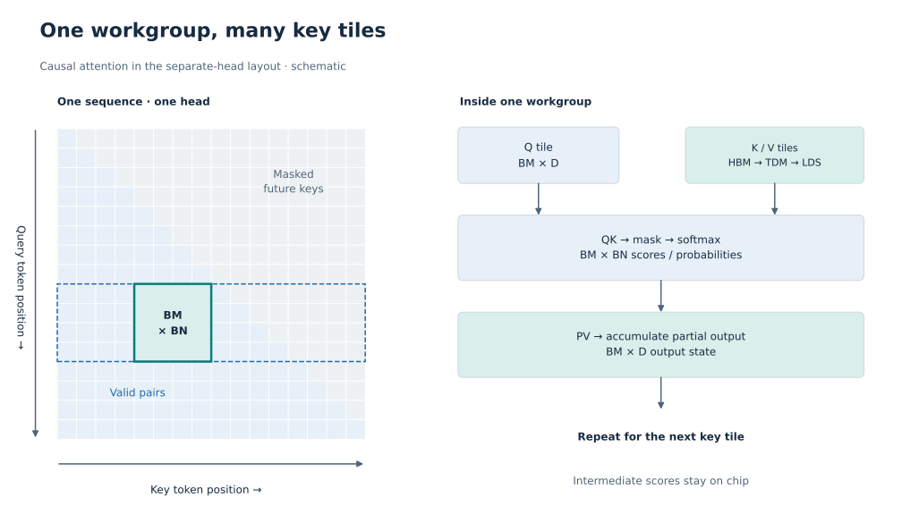
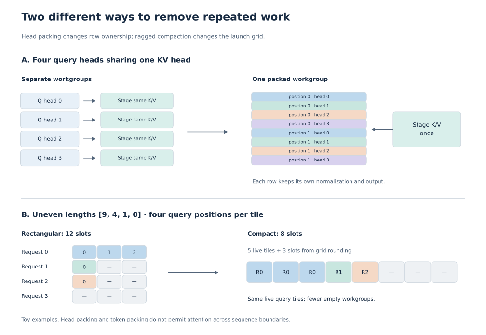
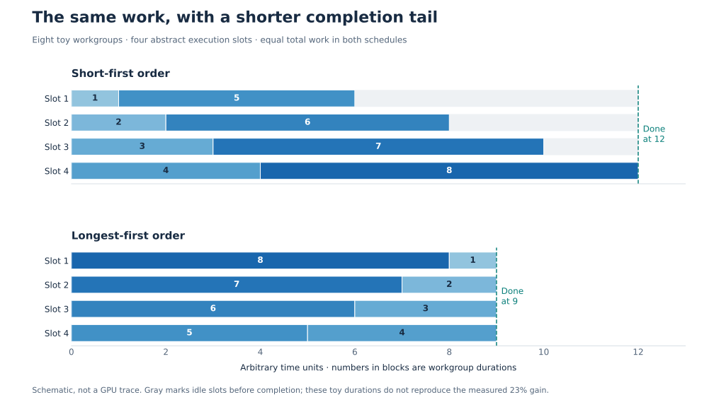
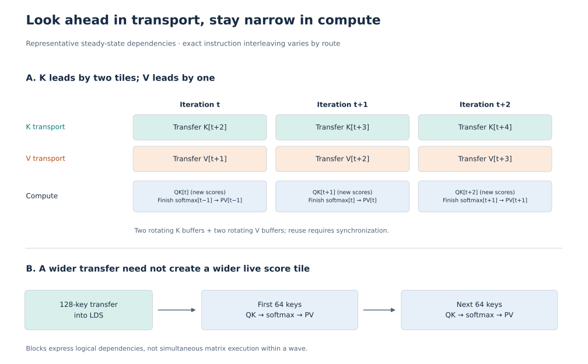
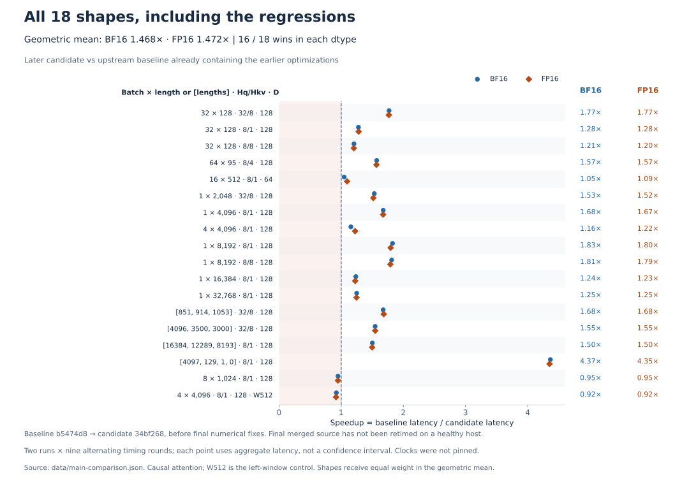

# Engineering a Faster FlashAttention Prefill Kernel on gfx1250

*By Nithin Meganathan. Kernel work through October 27, 2026.*

One of the largest gains in this project came from changing which work ran
first. In a measured causal-attention workload, scheduling the longest query
prefixes first raised throughput by **23%**, with essentially the same local
instruction stream. The GPU was doing the same attention calculation; it was
finishing the uneven pieces of that calculation more efficiently. [[1]](#reference-1)

That is the thread running through this work on TokenSpeed's Gluon prefill
kernel for gfx1250. We improved data reuse, removed empty and padded work,
overlapped transfers with computation, and reduced the normalization work
between matrix operations. Each change had to earn its place through timing
and numerical validation.

The later development campaign improved **16 of 18 configurations in each of
BF16 and FP16**, with geometric-mean speedups of **1.468× and 1.472×**. For one
8,192-token BF16 workload, latency fell from **118.6 μs to 65.0 μs**, and useful
causal throughput rose from **1,159 to 2,115 TFLOP/s**. These were additional
gains over a baseline that already contained the earlier optimizations in
this article. [[2]](#reference-2)

Those timings belong to a validated candidate **before the final numerical
fixes**. The final merged source has not been retimed on a healthy host. The
results below retain that boundary, include the two regressions, and describe
kernel performance rather than end-to-end model speedup.

## What one attention workgroup does

During prefill, attention processes the tokens of a prompt together. Each
query vector **Q** is compared with key vectors **K** to obtain scores. Softmax
turns those scores into weights, and the output is a weighted combination of
value vectors **V**. For one head:

$$
O = \mathrm{softmax}(s QK^{T} + M)V.
$$

Here, $s$ is usually $1/\sqrt{D}$, where D is the head dimension, and M applies
the mask. For causal attention, a query at position i can see keys through
position i, including itself. Later queries therefore have longer prefixes
to process.

[FlashAttention](https://arxiv.org/abs/2205.14135) computes this operation in
tiles, keeping intermediate scores and probabilities on chip instead of
writing full quadratic matrices to GPU memory. The kernel accumulates a
partial output and enough normalization state to combine the tiles.
[FlashAttention-2](https://arxiv.org/abs/2307.08691) also emphasizes work
partitioning and reducing non-matrix arithmetic. Those concerns matter
throughout this implementation.

Gluon gives us control over thread and shared-memory layouts, asynchronous
transfers, and matrix operations. The compiler turns that program into GPU
instructions. A launch creates a grid of **workgroups**. Each workgroup runs
on a compute unit and contains several 32-lane waves; Gluon calls the wave
count `num_warps`. Registers hold each lane's live values, while LDS is memory
shared within the workgroup. HBM holds the large input and output arrays.

*Figure 1. In the separate-head layout, one workgroup owns a tile of query rows
from one sequence and one head. It visits successive key tiles and accumulates
its output. The matrix drawing is schematic, not a measured workload.*

A **query row is one token's vector for one head**, not a whole sequence. In
the separate-head layout, a workgroup owns BM query rows and walks through keys
in BN-sized chunks. With BM=128, BN=64, and D=128, QK produces a `128 × 64`
score tile. After masking and exponentiation, PV contributes to a `128 × 128`
output accumulator.

Two hardware operations recur in the discussion: **TDM** moves tensors
asynchronously into LDS, and **WMMA** performs the matrix operations for QK
and PV. Keeping them productive requires balancing reuse against registers,
parallel work, and synchronization.

## Reuse more data without wasting the tile

The original production configuration used 128 query rows, 64 keys, four
waves, and two K/V buffers. A wider query tile lets more output rows reuse
staged K/V. But it also enlarges the FP32 output accumulator.

In the first screen, widening to 256 query rows with four waves gave **1.08×**.
Using eight waves with that wider tile gave **1.38×**: more lanes shared the
accumulator, reducing the per-lane register burden. The accepted policy gained
about **1.13–1.40×** across the measured BF16 workloads. [[3]](#reference-3)

A larger tile cannot win everywhere. It reduces the number of workgroups,
which can leave a small workload unable to fill the device. Near a causal
boundary, it also computes more entries that masking discards. The selector
therefore considered both sequence length and available work. Direct tests
covered both tile families, and a follow-up simplified the target's
occupancy cutoff. [[4]](#reference-4) [[5]](#reference-5)

These choices belong to their schedules. Later pipelines could use four waves
for some 256-row tiles because they changed how much state stayed live. A
wave-count rule from one experiment is not a property of every wide tile.

### Sharing K/V across query heads

Head sharing offers another kind of reuse. In multi-head attention, each query
head has its own KV head. Grouped-query attention lets several query heads
share a KV head; multi-query attention shares one KV head across all queries.
We write their counts as Hq and Hkv: Hq=32/Hkv=8 is a group of four.

Separate workgroups for those query heads repeat K/V staging. We instead
packed `(token position, query head within the group)` into matrix rows. With
eight query heads sharing K/V, 128 rows can represent **16 positions × 8
heads**. Each row retains its own scores, normalization, and output; the rows
reuse one staged K/V tile. [[6]](#reference-6)

The initial packed routes improved selected short, ragged, and windowed
workloads. One B4/S2048/Hq8/Hkv1/D128 case gained **22.88% in BF16** and
**12.72% in FP16**. Extending packed ownership to two longer BF16 routes later
gained **4.99% at B4/S4096** and **2.58% at B2/S8192** in a separate
campaign. [[7]](#reference-7)

*Figure 2. Head packing changes ownership inside a workgroup. Ragged compaction
changes how live query tiles map to the launch grid. Each preserves sequence
boundaries and per-head outputs. The toy grid includes rounding slots: a
compact launch need not contain exactly as many slots as live tiles.*

### Uneven sequences need a different launch

Real requests need not have equal lengths. This kernel accepts tokens packed
in memory, with cumulative offsets marking sequence boundaries. Lengths
`[3, 2, 4]`, for example, have offsets `[0, 3, 5, 9]`. A runtime can remove
padding before attention even if an earlier layer produced padded inputs.
Uniform and ragged batches can therefore share the same interface.

This packing of sequences in memory is distinct from packing query heads
into matrix rows. Neither allows attention to cross sequence boundaries.

A rectangular launch reserves query tiles for every request up to the batch's
maximum length. For highly uneven inputs, many slots have nothing to do.
Compaction maps live tiles onto a smaller grid. The later geometry policy
also broadened tile selection beyond a handful of exact shapes, using finite
buckets based on lengths, head sharing, and available query work. [[2]](#reference-2)

Short inputs have their own problem: padding matrix operations can cost more
than the useful arithmetic. One- and two-key-tile schedules avoid the setup
of a long loop. Partial query tiles can shrink their matrix operations while
reusing resident K/V, and selected short paths preserve wave ownership through
the output store to avoid rearranging data.

Together, the later changes moved the skewed batch `[4097, 129, 1, 0]` from
**128.7 μs to 29.5 μs in BF16**, a **4.37×** speedup. That measures the full
change, not compaction alone. Request counts and lengths remain runtime values
within a tile/feature bucket, so covering more input shapes need not mean
compiling a separate kernel for every length.

## Keep the useful work moving

Causal attention gives each query tile a different amount of work. At S4096,
BM256, and BN64, the first tile visits four key tiles; the last visits 64.
Launching short prefixes first can leave a few expensive workgroups running
after the rest of the device has finished.

Reversing the logical query-block order put long prefixes first and shortened
that completion tail. The measured acceptance case rose from **1,357 to 1,670
TFLOP/s**, or **23.08%**. Local register usage, matrix instructions, and barriers
were effectively unchanged. [[1]](#reference-1)

*Figure 3. An illustrative schedule, with identical work in both panels. These
are abstract execution slots and arbitrary time units, not a hardware trace.
The drawing explains the tail effect; its durations do not reproduce the
measured 23% gain.*

The gain depended on work distribution. It was strongest around two
workgroups per compute unit and much smaller when there was only one or many
rounds of work. For ragged inputs, the policy counted live tiles rather than
trusting the size of a mostly empty rectangular grid.

Instruction scheduling mattered too. A selected max-ILP compiler schedule
reduced register use and improved one acceptance case by **3.27%**. Restricting
TDM descriptor production to four waves of an eight-wave workgroup gained
**5.94%** in another campaign; all eight waves still computed. D64, windowed,
and other routes retained their own policies where these choices lost. [[8]](#reference-8) [[9]](#reference-9)

A later controlled replay enabled max-ILP, restricted TDM producers, and
longest-first order on one source snapshot and toolchain. Their combined gain
was **33.6% in BF16** and **31.7% in FP16** for B4/S4096/Hq8/Hkv1. That replay
supports a cumulative claim; adding gains from independent campaigns would not.

### The next bottleneck was inside the loop

Profiling redirected the work toward synchronization and the QK → softmax → PV
dependency chain. In the historical trace, only about 41–43% of co-resident
cycles had a wave issuing an instruction. A probe retaining the attention
core's dependencies fell below the estimated memory roof for that workload.
More bandwidth alone would not remove those waits.

K and V become useful at different times. K is needed to form scores; V is
needed after those scores become probabilities. The deeper schedule prepared
K two tiles ahead and V one tile ahead while processing older tiles. It used
two rotating buffers for each of K and V, with compile-time structure that
made buffer ownership and live ranges predictable. [[10]](#reference-10)

*Figure 4. Transfers look ahead while computation consumes earlier tiles. Each
compute block combines current-tile QK with the previous tile's softmax/PV;
exact instruction interleaving varies by route. Below, 128-key transport feeds
two 64-key compute steps.*

An earlier dynamic three-tile attempt had made the kernel slower: its
instruction count grew from 4,950 to 8,062 and live state lasted longer. The
successful version also specialized provably full tiles, removed unnecessary
bounds handling, and narrowed the output before its LDS shuffle. The combined
change gained **5.0–6.6%** across four measured D64/D128 BF16/FP16 workloads.

The later transport work separated transfer width from compute width. Selected
routes fetched 128 keys at once but consumed them as two 64-key steps,
amortizing transfer overhead without doubling the live score tile. Independent
softmax arithmetic and LDS reads filled gaps between matrix instructions.
Selected fused K/V transfers and ragged compaction completed that update;
changed BF16 routes gained **1.94–20.74%** in its campaign. [[11]](#reference-11)

More overlap was never automatically better. Extra producer/consumer waves,
longer live ranges, and additional prefetching could add spills or dependency
pressure. Removing necessary barriers produced incorrect output. Those failed
experiments helped distinguish a promising schedule from an implementation
that actually fit the hardware.

## Make softmax cheaper, with a way back

Matrix operations are only part of attention. Between QK and PV, the kernel
must mask scores, find maxima, compute exponentials, and update normalization.
Those repeated operations create dependencies in every key-tile iteration.

Standard online softmax keeps a running maximum m, denominator l, and
unnormalized output accumulator a for each query row. For a new tile of scaled,
masked scores x:

$$
\begin{aligned}
m' &= \max(m, \max_j x_j),\\
\alpha &= e^{m-m'}, \qquad p_j = e^{x_j-m'},\\
l' &= \alpha l + \sum_j p_j,\\
a' &= \alpha a + \sum_j p_j V_j.
\end{aligned}
$$

The final output is a/l. When a new maximum appears, rescaling the old state
lets all contributions share the new reference. The implementation uses
base-2 exponentials; these equations use natural exponentials for readability.

In real arithmetic, any constant reference cancels between numerator and
denominator. Eligible later routes exploit that fact by keeping the **first
tile's reference**. This removes repeated maximum updates and accumulator
rescaling. Some layouts also defer the cross-lane denominator reduction because
all probabilities share one scale. [[2]](#reference-2)

Floating-point arithmetic needs more care. Later scores can exceed the initial
reference enough to overflow exponentiation or conversion to FP16/BF16.
Subtracting a large reference after scaling can also lose precision even when
the provisional result is finite.

The kernel checks the reference shift, denominator, and normalized output.
The absolute base-2 shift must be at most 64, the denominator must lie in
`(0, 1e30)`, and the output must be finite and fit its dtype. If a valid row
fails, the workgroup **recomputes with online softmax in the same launch**,
overwriting provisional output and LSE. Padding rows do not trigger retry,
and guards evaluate current inputs on every graph replay.

This preserves a route for difficult inputs, with a cost: retry can execute
both passes. It also does not promise bitwise identity. QK and PV accumulate
in FP32; the denominator uses probabilities before rounding, while PV uses
probabilities rounded to the input dtype. Changing the reference can change
that rounding. Finite FP32 dot products and numerical agreement within the
validated tolerances remain part of the contract.

### The edge cases changed the implementation

Random inputs were not enough. Attention sinks add normalization mass without
a value contribution, while the optional **log-sum-exp (LSE)** output describes
key logits only. Large finite sinks and values exposed overflows that normal
inputs missed.

The fixes capped a sink-derived reference and, for BF16 with sinks and LSE,
scaled V by a sequence-length-dependent power of two with matching denominator
scaling. Scaling V preserved small probabilities that could multiply large
values; a prototype that scaled probabilities was discarded. Key-only LSE
remained separate from sink normalization.

Regression coverage checked storage offsets, empty and ragged boundaries,
changing graph inputs, feature fallbacks, and bounded compilation. The added
large-value test failed against the prior kernel and passed after the fix.
That negative control demonstrates why the test exists. Exact validation
snapshots and numerical contracts are linked in the [evidence companion](evidence.md).

## What the work changed

The main comparison below measures the later candidate against an upstream
baseline already containing the earlier work. It covers 18 configurations per
dtype, including short inputs, long sequences, MHA/GQA/MQA, ragged batches, and
a windowed control. Every shape contributes equally to the geometric mean;
this is not weighted by production traffic.

*Figure 5. Baseline `b5474d8` versus candidate kernel contents matching
`34bf268`. The candidate predates the final numerical fixes. Points use the
aggregate latencies from two runs; they are not confidence intervals. All 18
shapes, including both regressions, appear in the [retained data](data/main-comparison.json).*

The largest gains came from workloads with considerable room to improve work
distribution and reduce overhead. The skewed ragged case reached **4.37× in
BF16** and **4.35× in FP16**. The 8K single-sequence case reached **1.83× and
1.80×**, while 32K improved by about **1.25×** in both dtypes. At 32K, the
candidate delivered **2,515 BF16 and 2,432 FP16 TFLOP/s** of useful causal work.

The two regressions were B8/S1024/Hq8/Hkv1/D128, with about **5.4–5.5% higher
latency**, and B4/S4096/Hq8/Hkv1/D128 with left window 512, at **8.5–9.1%
higher latency**. They remain in the headline **1.468×/1.472×** geometric means.

“Useful TFLOP/s” counts QK and PV work for valid causal query/key pairs, with a
multiply-add counted as two operations:

$$
F = 2 H_q D \sum_b L_b(L_b+1).
$$

Dividing F by kernel time excludes masked matrix entries and softmax work
from the numerator. This makes avoided padding visible as improved useful
throughput. Windowed attention uses its actual allowed pair count.

The campaign used warmed graph timing, shared inputs/output, and two runs with
nine alternating timing rounds each. Independent FP64 checks sampled boundary
and interior query rows before and after timing, alongside whole-output
finiteness checks. `gpu-lock` serialized access, and process monitoring saw no
foreign GPU clients. **Clocks were not pinned.** Exact source/compiler versions
and per-run variation remain in the companion. The final numerical fixes were
validated separately; their merged source still needs a healthy-host timing run.

### How the vendor comparisons fit

An earlier development candidate was also tested against AITER assembly and
FlyDSL on 16 D128 shapes per dtype, spanning uniform and ragged inputs from
1K through 16K plus a 16,385-token tail. Across three matched sweeps, all 32
configurations beat every eligible measured vendor entry. Geometric-mean
speedups were **1.074× versus BF16 assembly**, **1.227× versus BF16 FlyDSL**, and
**1.217× versus FP16 FlyDSL**. Assembly was unavailable for FP16 in that build.

That result has a defined scope. A subsequent eight-process D64 confidence
run at B16/S512/Hq8/Hkv1 found BF16 ahead of assembly in every process but ahead
of the fastest FlyDSL entry in only three; FP16 won six of eight. The paired
geometric means versus FlyDSL were **0.973× and 1.025×**, respectively.
A separate stress test with storage offsets and amplified Q/K remained correct
but paid **2.45–2.64×** online-only-control latency through retry.

At causal MHA B1/S90000/Hq40/Hkv40/D128, another campaign found the candidate
competitive with both vendor implementations: **2,341 BF16 TFLOP/s** versus
2,325 for assembly and 2,331 for FlyDSL; **2,277 FP16 TFLOP/s** versus 2,254 for
FlyDSL. Those roughly 0.4–1.0% margins are small. They are a separate experiment,
not evidence of a universal lead or a cumulative gain across campaigns.

The [vendor evidence](evidence.md#historical-d128-vendor-sweep-and-d64-confidence-run)
and [90K results](evidence.md#separate-90k-vendor-comparison) retain the full
protocols and limitations. None of these kernel campaigns measures full-model
quality, end-to-end serving latency, or cold compilation cost.

## Keeping the improvements maintainable

The follow-up CI work put architecture-specific tests under `gfx950/` and
`gfx1250/`, grouped benchmark tests, and used those boundaries to select the
appropriate existing suites. Shared changes retain both suites, and
implementation changes retain an import/dispatch check on the other family.
The MI450 workflow uses the existing functional simulator; this is better
routing of coverage, not new hardware validation. [[12]](#reference-12)

The performance work changed how the GPU spends its time. More query rows
reuse staged data. Fewer launch slots and matrix rows do nothing. Uneven
causal work finishes with a shorter tail. Transfers arrive ahead of their
consumers, and eligible rows avoid repeated softmax state updates. Together,
those changes made a compiler-generated attention kernel substantially faster
across a broad measured workload set, with explicit boundaries for when the
faster algorithms apply.

## Contributions and references

I authored the eleven kernel optimization/validation changes and the CI
follow-up cited here. Pengzhan Zhao (`borontion`) is also credited as a
co-author of the final kernel update. [[2]](#reference-2)

The work builds on TokenSpeed's original implementation. [[13]](#reference-13) [[14]](#reference-14)
Pengzhan Zhao organized the AMD kernels by generation, [[15]](#reference-15) Zhewen Yu added
FP8 support, [[16]](#reference-16) and Lei Zhang updated the CDNA5 namespace and kernel
naming. [[17]](#reference-17) [[18]](#reference-18) Those contributions are part of the foundation, not
speedups attributed to this optimization series.

1.  **Schedule causal workgroups longest-first** — [TokenSpeed #1505](https://github.com/lightseekorg/tokenspeed/pull/1505).
2.  **Broaden prefill optimization and harden numerical behavior** — [TokenSpeed #2641](https://github.com/lightseekorg/tokenspeed/pull/2641).
3.  **Widen the query tile with eight-wave ownership** — [TokenSpeed #1332](https://github.com/lightseekorg/tokenspeed/pull/1332).
4.  **Cover both tile families** — [TokenSpeed #1337](https://github.com/lightseekorg/tokenspeed/pull/1337).
5.  **Simplify the occupancy cutoff** — [TokenSpeed #1357](https://github.com/lightseekorg/tokenspeed/pull/1357).
6.  **Pack GQA query rows and handle ragged/window boundaries** — [TokenSpeed #1924](https://github.com/lightseekorg/tokenspeed/pull/1924).
7.  **Extend packed ownership to long BF16 routes** — [TokenSpeed #1939](https://github.com/lightseekorg/tokenspeed/pull/1939).
8.  **Select instruction-level-parallelism scheduling** — [TokenSpeed #1476](https://github.com/lightseekorg/tokenspeed/pull/1476).
9.  **Restrict TDM producer participation** — [TokenSpeed #1496](https://github.com/lightseekorg/tokenspeed/pull/1496).
10.  **Deepen K/V overlap and specialize full tiles** — [TokenSpeed #1883](https://github.com/lightseekorg/tokenspeed/pull/1883).
11.  **Separate transport/compute width and tune packed routes** — [TokenSpeed #1941](https://github.com/lightseekorg/tokenspeed/pull/1941).
12.  **Organize architecture-specific tests and CI coverage** — [TokenSpeed #2743](https://github.com/lightseekorg/tokenspeed/pull/2743).
13.  **Introduce the original kernel on the staging branch** — [TokenSpeed #718](https://github.com/lightseekorg/tokenspeed/pull/718).
14.  **Land the original implementation** — [TokenSpeed #719](https://github.com/lightseekorg/tokenspeed/pull/719).
15.  **Organize AMD kernels by generation** — [TokenSpeed #880](https://github.com/lightseekorg/tokenspeed/pull/880).
16.  **Add FP8 support** — [TokenSpeed #953](https://github.com/lightseekorg/tokenspeed/pull/953).
17.  **Adopt the CDNA5 namespace** — [TokenSpeed #1411](https://github.com/lightseekorg/tokenspeed/pull/1411).
18.  **Align kernel names with registration** — [TokenSpeed #1678](https://github.com/lightseekorg/tokenspeed/pull/1678).

The [evidence companion](evidence.md) preserves historical campaign tables,
rejected experiments, source identities, and validation details. The
[merged implementation](https://github.com/lightseekorg/tokenspeed/blob/091a4fc66dc024458605af6db6e384d08d52cb2b/tokenspeed-kernel-amd/python/tokenspeed_kernel_amd/ops/gfx1250/attention/mha/prefill.py)
and [numerical contract](https://github.com/lightseekorg/tokenspeed/blob/091a4fc66dc024458605af6db6e384d08d52cb2b/tokenspeed-kernel-amd/python/tokenspeed_kernel_amd/ops/README.md#gfx1250-mha-prefill)
provide the code-level detail.
