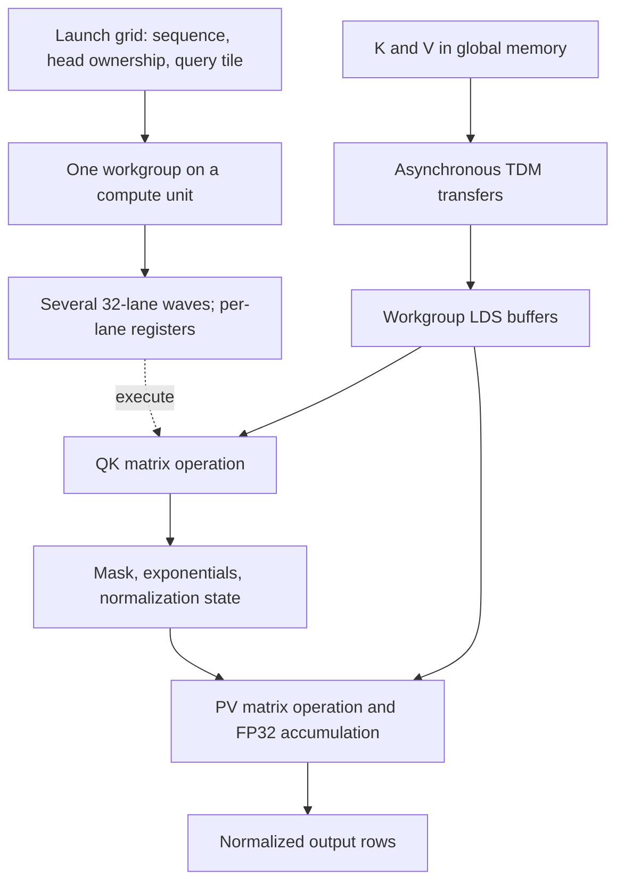
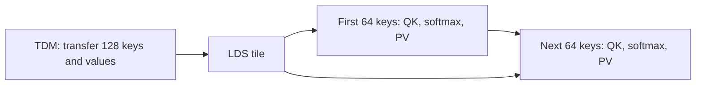

# Engineering a Faster FlashAttention Prefill Kernel on gfx1250

*By Nithin Meganathan. Updated through [TokenSpeed #2641](https://github.com/lightseekorg/tokenspeed/pull/2641), merged October 27, 2026. Draft for technical review.*

A fast attention kernel has to do more than keep its matrix units busy. It has
to give them useful work, bring in the next operands on time, and get through
softmax without spending its register budget on intermediate results. Causal
attention adds another complication: some workgroups have far more work than
others.

This is the story of optimizing TokenSpeed's Gluon prefill kernel on gfx1250.
Across eleven merged optimization and validation PRs, we changed the size and
ownership of query tiles, the order in which work reaches the GPU, the overlap
between K/V transfers and computation, and eventually the normalization inside
the attention loop. Some of the largest gains came from avoiding work: empty
ragged tiles, padded matrix rows, and repeated softmax state updates.

In the latest retained comparison against `main`, the candidate improved 16 of
18 configurations in **each** of BF16 and FP16, with geometric-mean speedups of
**1.468× and 1.472×**. One BF16 sequence of 8,192 tokens, eight query heads,
one KV head, and head dimension 128 went from **1,159 to 2,115 TFLOP/s** of
useful causal work. A strongly imbalanced ragged batch improved by **4.37×**.
Two configurations regressed.

Those are kernel measurements from the validated candidate campaign, **before
the final numerical fixes in #2641**. The host was subsequently reported as
performance-degraded, so we retained the earlier numbers rather than present a
fresh timing claim for the merged code. The [results section](#what-the-measurements-support)
and [evidence notes](evidence.md) give the exact revisions, regressions, and
measurement limits.

## What the kernel is computing

During prefill, attention processes the tokens of an input prompt together.
For one head, its central computation is

$$
O = \operatorname{softmax}(s QK^\mathsf{T} + M)V,
$$

where $s$ is usually $1/\sqrt{D}$ and $M$ applies the attention mask. In causal
attention, query position $i$ can see keys through position $i$, including
itself. Each later query therefore has a longer prefix to process.

The straightforward implementation materializes a matrix of scores and then a
matrix of probabilities. Both grow quadratically with sequence length.
[FlashAttention](https://arxiv.org/abs/2205.14135) avoids storing these full
matrices in GPU memory: it computes attention in tiles, retaining enough
normalization state to combine the partial results. It preserves the attention
operation while changing how that operation moves through memory.
[FlashAttention-2](https://arxiv.org/abs/2307.08691) further emphasizes work
partitioning and reducing non-matrix work. Those concerns are central here.

“FAv3” was our working name for this kernel effort. The code and mechanisms
below are a specific Gluon implementation; the name does not imply that every
optimization is an implementation of a particular paper's schedule. Gluon
lets us express thread layouts, shared-memory layouts, asynchronous transfers,
and matrix operations while the compiler produces the GPU instructions.

### Sequences, heads, and two meanings of packing

A shape such as `B=16, S=512, Hq=8, Hkv=1, D=64` means sixteen sequences, each
with 512 tokens, eight query heads, one shared KV head, and 64 components per
head. A query row is a token's vector for a particular head. **It is not a
whole input sequence.** Tokenization determines the tokens; these sequences
could be prompts containing several sentences.

Real batches need not have equal lengths. This kernel accepts packed token
arrays and cumulative sequence offsets, conventionally called `cu_seqlens`:

```text
Lengths:             [3, 2, 4]
Token storage:       [a0 a1 a2 | b0 b1 | c0 c1 c2 c3]
Cumulative offsets:  [0, 3, 5, 9]
```

Each sequence still attends only within its own boundaries. A tokenizer or
another runtime layer may initially pad inputs; the runtime can remove that
padding before calling attention. Uniform batches and ragged batches can use
the same packed interface. “Dense” attention describes the connections within
each sequence; it does not require every sequence in a batch to have the same
length.

Head sharing is a separate dimension:

| Head arrangement | Relationship | Example |
|---|---|---|
| Multi-head attention, MHA | One KV head per query head | Hq=8, Hkv=8 |
| Grouped-query attention, GQA | Several query heads share each KV head | Hq=32, Hkv=8 |
| Multi-query attention, MQA | All query heads share one KV head | Hq=8, Hkv=1 |

Later, we will **pack query heads into matrix rows** to exploit that sharing.
That is a compute layout inside the kernel, distinct from packing variable-length
sequences in memory. The causal BF16/FP16, D64/D128 paths are the focus of the
latest work. The existing kernel also has FP8, sliding-window, sink, and LSE
support; those features do not all use the same optimized route.

## From a query tile to the GPU

A kernel launch creates a grid of workgroups. Each workgroup runs on a compute
unit, uses its own shared local memory, and contains several waves of threads.
For these gfx1250 kernels, a wave has 32 lanes; Gluon calls the wave-count
parameter `num_warps`. Registers hold each lane's live values. LDS is the
on-chip memory shared by the workgroup. HBM holds the large input and output
arrays, with caches between HBM and the compute units.

Two facilities matter throughout this story. **TDM** performs asynchronous
tensor transfers into LDS. **WMMA** performs the matrix operations used for
both $QK^\mathsf{T}$ and $PV$.



In the separate-head layout, a workgroup owns `BM` query rows of one sequence
and one query head. It walks through keys in chunks of `BN`. A `BM=128,
BN=64, D=128` iteration multiplies a `128×128` query tile by a `128×64` key
tile, producing `128×64` scores. After masking and exponentiation, those
probabilities multiply a `64×128` value tile and contribute to a `128×128`
output accumulator.

`BM` and `BN` describe matrix dimensions, not numbers of sequences. Wider
tiles can reuse data more efficiently, but they also consume more registers,
change the number of workgroups, and perform more masked work near boundaries.
That tradeoff drove the first change.

## A larger tile needs the right ownership

The original production configuration used 128 query rows, 64 keys, four
waves, and two K/V buffers. In [#1332](https://github.com/lightseekorg/tokenspeed/pull/1332),
we widened the query tile to 256 rows. In the initial screen, doubling the
query rows while retaining four waves gave only **1.08×**. Pairing 256 rows
with eight waves gave **1.38×**.

The extra waves distributed the larger FP32 accumulator across more lanes.
That reduced the per-lane register burden and made the increased reuse viable.
The accepted policy improved the tested BF16 Hq=32/Hkv=8/D128 workloads by
roughly **1.13–1.40×**, depending on sequence lengths and batch size.

It could not be enabled everywhere. Doubling `BM` roughly halves the number
of query workgroups; a small workload may then fail to fill the device. A
wider diagonal tile also computes more matrix entries that the causal mask
will discard. That waste is a larger fraction of a short sequence's work.
The selector therefore considered both sequence length and available work.

[#1337](https://github.com/lightseekorg/tokenspeed/pull/1337) added direct
coverage of both tile families and selector boundaries, including D64/D128
and sliding windows. [#1357](https://github.com/lightseekorg/tokenspeed/pull/1357)
replaced a launch-time compute-unit query with the target's fixed 256-CU cutoff.
These were validation and launch-policy changes, not additional measured
kernel speedups.

The wave-count choice was specific to that schedule. Later pipelines could
use four waves for some 256-row tiles. “Eight waves was faster” describes an
experiment with a particular live-state layout, not a rule for all wide tiles.

## Scheduling happens at two scales

At the instruction level, a wave can be blocked by a dependency even when
other useful operations are available. In
[#1476](https://github.com/lightseekorg/tokenspeed/pull/1476), selecting LLVM's
`max-ilp` schedule for measured D128 full-attention routes reduced VGPR use
from 488 to 466 and improved the acceptance case from **1,510.4 to 1,559.8
TFLOP/s**, or **3.27%**. D64, short inputs, and sliding windows did not inherit
this policy indiscriminately: some windowed cases regressed.

[#1496](https://github.com/lightseekorg/tokenspeed/pull/1496) narrowed TDM
descriptor production to four of an eight-wave workgroup's waves. All eight
waves still participated in computation. This was a producer-participation
hint, not four permanently dedicated producer waves and four consumer waves.
Keeping separate K and V transfer events preserved their different readiness
points. The acceptance case improved by **5.94%**.

At the device level, a different problem appeared. For a causal S4096 input
with `BM=256` and `BN=64`, the first query tile visits four key tiles, while
the last visits 64. Launching short prefixes first can leave a few expensive
workgroups running after much of the device has finished.

In [#1505](https://github.com/lightseekorg/tokenspeed/pull/1505), we reversed
the logical query-block order for eligible launches, putting long prefixes
first. We changed the work distribution without changing the answer or
materially changing the local instruction stream. The acceptance case rose
from **1,357.0 to 1,670.2 TFLOP/s**, a **23.08%** gain.

The effect was strongest with about two workgroups per CU. With many rounds of
work, the device had more opportunities to balance itself; with only one
workgroup per CU, reordering could do little. For ragged inputs, we counted
live tiles rather than treating every sequence as if it had the maximum
length. A large rectangular grid can hide very little real work.

These three changes were later replayed together on one source snapshot and
toolchain. For B4/S4096/Hq8/Hkv1, their combined gain was **33.6% in BF16** and
**31.7% in FP16**. That controlled replay supports the combined attribution.
Adding percentages from the original, separate campaigns would not.

## The trace pointed inside the attention loop

At this stage, it was tempting to keep chasing memory bandwidth. The profiling
campaign pointed elsewhere. A probe retaining the LDS → QK → softmax → PV
dependency chain reached about **2,460 TFLOP/s**, below the estimated memory
roof for the measured workload. Production still spent substantial time in
barriers and tensor/LDS waits. Only about 41–43% of co-resident cycles had a
wave issuing an instruction in that trace.

This was a roof for that probe, source, and compiler—not an immutable gfx1250
hardware limit. The useful result was the diagnosis: there was opportunity in
the dependency chain and synchronization, even with a highly active GPU.
Later kernels exceeding this old probe's throughput are not a contradiction.
The [historical evidence](evidence.md#profiling-and-rejected-experiments)
records its provenance and the experiments that failed.

### K must arrive before V

For a given key tile, K is needed to form scores. V is only needed after those
scores have become probabilities. Loading both at the same depth misses an
opportunity to overlap different stages.

[#1883](https://github.com/lightseekorg/tokenspeed/pull/1883) made that
asymmetry explicit: K could be prepared two tiles ahead, V one tile ahead,
while QK work overlapped the previous tile's softmax and PV work. We expressed
the schedule with compile-time structure so buffer ownership and live ranges
were predictable.

An earlier dynamic three-tile experiment had lost performance: its instruction
count grew from 4,950 to 8,062 and live state lasted longer. The eventual
schedule used two rotating K/V buffers with carefully ordered transfers and
reads. “Deeper pipeline” did not mean allocating an unbounded queue of tiles.
Removing a wait or barrier was also not a free optimization: experiments that
broke cross-wave LDS visibility produced incorrect output.

We coupled the pipeline with specializations for provably full query tiles:
remove unnecessary bounds handling, simplify invalid-row repair, shorten
softmax live ranges, and convert the output before its LDS shuffle so the
shuffle moved fewer bytes. Together, these changes improved the four measured
B4/S4096 D64/D128 BF16/FP16 cases by **5.0–6.6%**. That figure belongs to the
combined change, not the pipeline alone.

### Transfer width and compute width need not match

In [#1941](https://github.com/lightseekorg/tokenspeed/pull/1941), selected
routes transferred 128 keys at a time but consumed them as two 64-key matrix
steps:



This amortized transfer overhead without requiring a 128-column score tile to
remain live throughout computation. We also interleaved independent softmax
arithmetic and LDS reads between matrix instructions. A WMMA instruction stream
with fewer exposed dependency gaps can outperform one that simply groups more
matrix instructions together.

Selected BF16 Hq32/Hkv8 routes benefited from fused K/V transfers with distinct
producer-wave masks. MQA did not, so that choice stayed narrow. The final
#1941 acceptance campaign improved changed BF16 routes by **1.94–20.74%**.
Its compiler and baseline differed from the earlier campaigns; the evidence
notes keep those comparisons separate.

## Share K/V across heads, then stop launching empty work

For GQA and MQA, several query heads read the same K/V head. A separate
workgroup for every query head repeats that staging work. In
[#1924](https://github.com/lightseekorg/tokenspeed/pull/1924), we packed
`(query position, query head within the group)` into the matrix's row dimension.

With eight query heads sharing one KV head, a 128-row tile can represent
**16 token positions × 8 heads**. Each row still has its own scores, softmax,
and output. The rows share the same staged K/V tile; they are not averaged or
merged into a single head.

This gave substantial gains on selected short, ragged, and windowed routes.
For example, B4/S2048/Hq8/Hkv1/D128 improved by **22.88% in BF16** and
**12.72% in FP16** in that campaign. The sliding-window improvement also
included mask-free interior tiles and scheduling changes, so its roughly
67–69% gain cannot be attributed to head packing alone.

Packed rows exposed a boundary detail: padding can create rows with no valid
keys. A finite initial maximum avoids the undefined `-inf - -inf` operation
for those rows; masking still makes their probabilities zero. It is a small
piece of numerical handling that allows the layout optimization to work.

[#1939](https://github.com/lightseekorg/tokenspeed/pull/1939) extended packed
ownership to two measured long BF16 routes, gaining **4.99% at B4/S4096** and
**2.58% at B2/S8192**. #1941 then compacted a selected ragged launch. With
lengths `[4096, 3584, 2305, 1024]` and a 16-position query span, there are 689
live query tiles per KV head, compared with 1,024 slots in the rectangular
grid. Compact mapping makes the launch represent actual work more closely.

### Extending the policy beyond a handful of shapes

The latest PR, [#2641](https://github.com/lightseekorg/tokenspeed/pull/2641),
carried these ideas across a broader BF16/FP16 shape space. Instead of relying
only on a few exact-shape routes, it selects from finite tile and wave-count
buckets using sequence lengths, head sharing, and available query work.
Compatible GQA groups can share K/V; heavily imbalanced ragged batches can
compact their live tiles. Existing feature-specific routes retain their
eligibility checks.

Short attention needs a different schedule from a long key loop. One- and
two-key-tile cases use short schedules, including asynchronous Q loads and
fused K/V transfers where selected. Partial query tiles can use smaller matrix
operations while reusing resident K/V. Eight-wave short tiles preserve their
wave ownership through output stores, avoiding unnecessary rearrangement.

This explains why seemingly awkward lengths matter. A 95-token input is not
just a benchmark curiosity: it tests what happens between convenient tile
boundaries. Padding that input to a wide matrix can waste a significant part
of a microsecond-scale kernel. An even sharper case is `[4097, 129, 1, 0]`:
treating every request as a 4,097-token sequence creates a mostly empty launch.
The combined #2641 changes improved this case from about **267 to 1,167
TFLOP/s in BF16**. That is a package result, not an isolated 4.37× gain from
compaction alone.

Specialization also has a cost outside the timed kernel. Request counts,
uniform lengths, and tail lengths remain runtime values; changing them within
a tile/feature bucket should not compile another kernel. The final review
split geometry selection and grid construction into small helpers without
changing their policy. A CPU comparison checked 465,360 configurations for
equivalent selection and applied grid/flags. This checks the refactor's
behavior; it does not replace GPU numerical testing.

## Making softmax cheaper without hiding its numerical contract

The later optimization reached the loop's repeated normalization work. To see
what changed, consider the standard online softmax. For each row, keep a
running maximum $m$, denominator $l$, and unnormalized output accumulator $a$.
For a new tile of scaled, masked scores $x$:

$$
\begin{aligned}
m' &= \max(m, \max_j x_j),\\
\alpha &= e^{m-m'}, \qquad p_j = e^{x_j-m'},\\
l' &= \alpha l + \sum_j p_j,\\
a' &= \alpha a + \sum_j p_j V_j.
\end{aligned}
$$

At the end, $O=a/l$. Updating the reference maximum keeps exponentials bounded,
but it also introduces reductions and rescaling of accumulated state on every
key tile. The implementation uses base-2 exponentials and folds the conversion
factor into the scale; the equations above use natural exponentials for
readability.

A constant reference shift cancels between numerator and denominator in real
arithmetic. #2641 uses that fact on eligible paths: take the first tile's
reference and keep it for later tiles. This removes repeated maximum updates
and accumulator rescaling. Because probabilities now share one scale,
selected layouts can also accumulate local denominator terms and defer their
cross-lane reduction.

Floating-point arithmetic makes the qualification essential. A later score can
be much larger than the first tile's reference. Exponentiation or conversion
to FP16/BF16 can overflow. Even a finite result can have unacceptable error if
forming a scaled score minus a large reference loses precision.

The kernel therefore checks the computed state for valid rows:

- the absolute reference shift in base-2 units must be at most 64;
- the denominator must be positive and below `1e30`;
- the normalized output must be finite and within the output dtype's range.

NaN-propagating reductions participate in that decision. If any valid row
fails, the workgroup **recomputes its attention with online softmax in the same
launch**, overwriting provisional output and LSE before returning. Masked
padding rows do not trigger retry. The checks run on the current values on
every graph replay, including when a captured graph receives different inputs.

| Normalization path | Where it applies | Cost and numerical behavior |
|---|---|---|
| Online softmax | General route, including FP8 and windows | Update the maximum and rescale state per key tile. |
| Single-tile normalization | Selected short BF16/FP16 layouts | One tile maximum; no long recurrence to pipeline. |
| Fixed first-tile shift | Eligible four-wave BF16/FP16 D64/D128 routes, no window, at least three key tiles | Avoid repeated updates; accept only guarded state. |
| Online retry | A fixed-shift workgroup fails a guard | Pay for recomputation within the same launch. |

This is not a promise of a speedup on arbitrary value distributions. High-range
inputs can pay for both passes. Nor is it bitwise equivalence: QK and PV
accumulate in FP32, the denominator uses probabilities before rounding, and PV
uses probabilities rounded to the input dtype. A different reference can
change that rounding. The contract is agreement within tested numerical
tolerances, with finite FP32 dot products as a prerequisite.

### Review found cases that random inputs did not

Attention sinks and LSE made the final review particularly useful. A sink adds
normalization mass without a corresponding value contribution. TokenSpeed's
LSE output describes the **key logits only**, excluding sinks. Output
normalization and LSE therefore cannot simply share a sink-dominated reference
without care.

One regression used a very large but finite BF16 sink. Converting its reference
back to unscaled score units overflowed; capping that conversion fixed the
case. Another involved large finite BF16 values when both sinks and LSE were
requested: the PV sum could overflow before the sink reduced the final result.

The final fix scales **V**, using a sequence-length-dependent power of two,
and applies the matching factor to the final denominator. Scaling V preserves
small probabilities that may multiply large values. An earlier prototype
scaled probabilities instead and was replaced for that reason. Key-only LSE
is written before sink normalization, and the fix does not change probability
rounding in this path.

These fixes are part of the merged code. The last targeted hardware run passed
62 tests; the added large-value regression failed against the previous kernel,
as intended. Earlier, the performance candidate had passed 253 kernel tests
and 28 generic API tests. These are different validation snapshots, not a claim
that every broad test was rerun after the final fix.

The coverage also exercises storage offsets, ragged and empty boundaries,
feature fallbacks, changing inputs under graph replay, and bounded JIT
specialization. Simulator coverage checks the selected wide-transport
variants. Each protects a concrete behavior that the optimization could break.

## What the measurements support

For full causal attention with equal query/key lengths, the useful matrix
work is

$$
F = 2 H_q D \sum_b L_b(L_b+1).
$$

There are $L(L+1)/2$ valid query/key pairs. Each pair contributes $2D$ FLOPs to
QK and $2D$ to PV, counting a multiply-add as two operations. Dividing this
useful work by elapsed kernel time gives the TFLOP/s reported here. It excludes
masked matrix entries and softmax operations; it is not a count of every
instruction executed. Sliding windows use their actual allowed pair count.

The #2641 campaign compared baseline
[`b5474d8`](https://github.com/lightseekorg/tokenspeed/commit/b5474d8da835aa1e9562bc66f9e9bdcbb77913da)
with candidate kernel contents matching
[`34bf268`](https://github.com/lightseekorg/tokenspeed/commit/34bf268840a553cbc02b3dadcb41bb54d13180d0).
It used two runs with nine alternating graph-timing rounds per shape and dtype,
shared inputs/output, warmed kernels, and independent FP64 checks on sampled
query rows before and after timing. The checks covered boundary and interior
positions, alongside a whole-output finiteness check.
GPU access was serialized with `gpu-lock`, and monitoring observed no foreign
GPU clients. **Clocks were not pinned.**

Representative results below are rounded useful causal TFLOP/s. D is 128
unless noted. `Hq:Hkv` describes head sharing, not the number of sequences.

| Sequence lengths | B | Hq:Hkv | D | BF16 main → candidate | FP16 main → candidate |
|---|---:|---:|---:|---:|---:|
| 128 each | 32 | 32:8 | 128 | 303 → 537 (1.77×) | 302 → 533 (1.77×) |
| 512 each | 16 | 8:1 | 64 | 475 → 498 (1.05×) | 469 → 514 (1.09×) |
| 4096 | 1 | 8:1 | 128 | 736 → 1,233 (1.68×) | 730 → 1,223 (1.67×) |
| 8192 | 1 | 8:1 | 128 | 1,159 → 2,115 (1.83×) | 1,148 → 2,061 (1.80×) |
| 16384 | 1 | 8:1 | 128 | 1,975 → 2,440 (1.24×) | 1,921 → 2,353 (1.23×) |
| 32768 | 1 | 8:1 | 128 | 2,013 → 2,515 (1.25×) | 1,952 → 2,432 (1.25×) |
| `[4096, 3500, 3000]` | 3 | 32:8 | 128 | 1,318 → 2,037 (1.55×) | 1,293 → 2,000 (1.55×) |
| `[4097, 129, 1, 0]` | 4 | 8:1 | 128 | 267 → 1,167 (4.37×) | 266 → 1,157 (4.35×) |

The complete 18-shape matrix includes two regressions, in both dtypes:

| Configuration | BF16 latency increase | FP16 latency increase |
|---|---:|---:|
| B8/S1024/Hq8/Hkv1/D128 | 5.4% | 5.5% |
| B4/S4096/Hq8/Hkv1/D128, left window 512 | 8.5% | 9.1% |

The 1.468×/1.472× geometric means include these rows and weight every shape
equally. They are not workload-frequency-weighted serving speedups. D64 FP16
at S512 also varied from 1.05× to 1.15× between the two runs; its aggregate is
useful, but more variable than the large D128 gains.

The [full table and retained samples](data/main-comparison.json) preserve
latencies, useful work counts, per-run speedups, and numerical checks. The
merged kernel includes subsequent numerical fixes and has a different source
hash. We have not re-established these timings for that final source on a
healthy host.

### A separate check at 90,000 tokens

We also compared a pre-final-fix #2641 revision with AITER assembly and FlyDSL
on causal MHA `[B=1, S=90000, Hq=Hkv=40, D=128]`. This was a separate campaign,
using AITER `2bafed472893`, three fresh-process runs, and 13 paired timing rounds
per run. Both batch and varlen vendor APIs were measured; the table shows the
varlen entries, which had slightly lower aggregate medians.

| Dtype | TokenSpeed | AITER assembly | AITER FlyDSL |
|---|---:|---:|---:|
| BF16 latency | 35.434 ms | 35.674 ms | 35.591 ms |
| BF16 useful TFLOP/s | 2,341 | 2,325 | 2,331 |
| FP16 latency | 36.426 ms | Unavailable in tested build | 36.794 ms |
| FP16 useful TFLOP/s | 2,277 | — | 2,254 |

The candidate's BF16 median was about 0.7% faster than assembly and 0.4% faster
than FlyDSL; FP16 was about 1.0% faster than FlyDSL. These are **small margins
on one shape**, with unpinned clocks. They support competitiveness in that
experiment, not a universal vendor-kernel win. Numerical checks covered 40
selected query positions, including tile boundaries and late positions, rather
than the entire 90,000-row output. The
[retained comparison](data/90k-comparison.json) includes all measured APIs,
per-run ranges, and reference errors.

Neither this comparison nor the main-versus-candidate matrix measures full
model generation, end-to-end serving latency, or model quality. Compilation
and warmup are outside the steady-state timings.

## Where the contributions fit

I authored the eleven optimization and validation PRs below. They build on
TokenSpeed's existing implementation and its maintainers' work; this series
did not introduce FlashAttention, the original kernel, or FP8 support.
Pengzhan Zhao (`borontion`) is also credited as a co-author of the merged
#2641 change.

| PR | Contribution in this series |
|---|---|
| [#1332](https://github.com/lightseekorg/tokenspeed/pull/1332) | Wider query tiles with appropriate wave ownership |
| [#1337](https://github.com/lightseekorg/tokenspeed/pull/1337) | Tile-family and selector coverage |
| [#1357](https://github.com/lightseekorg/tokenspeed/pull/1357) | Simpler occupancy cutoff |
| [#1476](https://github.com/lightseekorg/tokenspeed/pull/1476) | Selected max-ILP instruction scheduling |
| [#1496](https://github.com/lightseekorg/tokenspeed/pull/1496) | TDM producer participation |
| [#1505](https://github.com/lightseekorg/tokenspeed/pull/1505) | Longest-first causal work distribution |
| [#1883](https://github.com/lightseekorg/tokenspeed/pull/1883) | Deeper K/V overlap and full-tile specialization |
| [#1924](https://github.com/lightseekorg/tokenspeed/pull/1924) | Packed GQA, ragged tails, and window handling |
| [#1939](https://github.com/lightseekorg/tokenspeed/pull/1939) | Long BF16 packed routes |
| [#1941](https://github.com/lightseekorg/tokenspeed/pull/1941) | Wider transfers, compact ragged work, and instruction overlap |
| [#2641](https://github.com/lightseekorg/tokenspeed/pull/2641) | Broader geometry policy, short/tail schedules, guarded softmax, and numerical hardening |

The original kernel arrived through
[#718](https://github.com/lightseekorg/tokenspeed/pull/718) and
[#719](https://github.com/lightseekorg/tokenspeed/pull/719).
Pengzhan Zhao organized AMD kernels by generation in
[#880](https://github.com/lightseekorg/tokenspeed/pull/880);
Zhewen Yu added FP8 support in
[#953](https://github.com/lightseekorg/tokenspeed/pull/953).
Lei Zhang's [#1411](https://github.com/lightseekorg/tokenspeed/pull/1411) and
[#1678](https://github.com/lightseekorg/tokenspeed/pull/1678) updated the CDNA5
namespace and registered-kernel naming. These changes are part of the kernel's
lineage, rather than performance gains attributed to this series.

For implementation details, read the
[merged kernel](https://github.com/lightseekorg/tokenspeed/blob/091a4fc66dc024458605af6db6e384d08d52cb2b/tokenspeed-kernel-amd/python/tokenspeed_kernel_amd/ops/gfx1250/attention/mha/prefill.py)
and its
[numerical contract](https://github.com/lightseekorg/tokenspeed/blob/091a4fc66dc024458605af6db6e384d08d52cb2b/tokenspeed-kernel-amd/python/tokenspeed_kernel_amd/ops/README.md#gfx1250-mha-prefill).
The [evidence notes](evidence.md) retain the historical campaign tables and
explain how the latest data was collected. The next performance claim needs a
healthy-host rerun of the final merged source, including the two regressions
and inputs that exercise retry.
